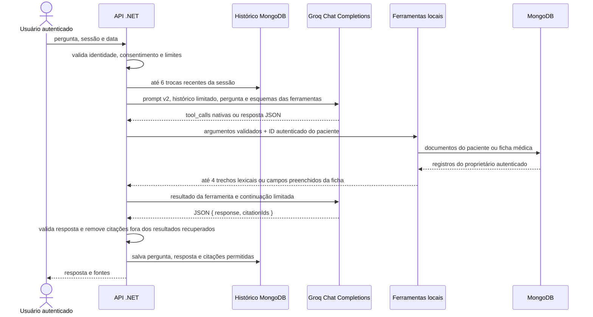

# Arquitetura de IA do SaúdeMemora

## Auditoria e decisões

- O backend é ASP.NET Core 9 e usa Groq no chat, Gemini na extração e nos relatórios, OCR.Space para texto e MongoDB para os registros. O `docker-compose.yml` inicia MongoDB 7 local; não há configuração de MongoDB Atlas Vector Search, pgvector, geração de embeddings ou armazenamento de vetores.
- O chat anterior enviava perfil, ficha e todos os documentos em cada pergunta. Também enviava até dez trocas de histórico sem orçamento e registrava o corpo de erro do Groq.
- A aplicação já tinha `ResilientHttpSender` e circuit breaker, mas o chat não os utilizava. A extração usava uma chave Gemini numa variável chamada Groq e podia deixar de tentar Groq quando Gemini não estivesse configurado.
- O fluxo curto de leitura de registros cabe no backend .NET: não foi adicionada dependência LangChain, LangGraph nem um serviço Python. LangChain não reduziria a complexidade de duas ferramentas locais; LangGraph seria útil quando houver etapas com estado, aprovações ou recuperação retomável. Um sidecar Python também exigiria autenticação entre serviços, deploy, monitoramento e mais uma superfície operacional sem uma necessidade atual que compense esse custo.
- Não foi iniciado fine-tuning. Não há uma tarefa de classificação avaliada nem um conjunto de dados sintético de treino/validação que demonstre uma vantagem sobre prompts, saída estruturada e recuperação.

## Fluxo do chat



O chat verifica consentimento antes de consultar ficha ou documentos. As ferramentas são somente leitura e não recebem `PacienteId` ou IDs de documentos nos argumentos. A identidade vem da requisição autenticada; a busca também confere o proprietário de cada documento antes de retornar trechos. O loop permite no máximo duas rodadas de ferramenta, quatro chamadas executadas e uma resposta final sem ferramentas.

## Recuperação e RAG

`IPatientDocumentSearch` separa a estratégia de busca do executor de ferramentas. O adaptador atual, `LexicalPatientDocumentSearch`, busca documentos processados do usuário autenticado, classifica os campos por sobreposição de termos e devolve até quatro trechos curtos com ID, título, data e tipo. O backend guarda a lista recuperada e só persiste citações que estejam nessa lista.

Essa implementação não usa embeddings, vetor nem busca semântica. O repositório não configura a infraestrutura necessária, e a consulta lexical percorre os documentos daquele paciente em memória; o custo cresce com o arquivo de cada usuário. Para busca semântica, será necessário escolher e provisionar um banco vetorial compatível, um provedor/modelo de embeddings autorizado, indexação idempotente e reindexação versionada. Só depois disso um adaptador vetorial deve substituir `IPatientDocumentSearch`. A implementação atual não envia dados a um novo provedor de embeddings.

## Prompts, contexto e respostas

- O prompt do chat está centralizado em `ChatPromptBuilder` e versionado como `patient-record-chat-v2`. Os prompts de OCR e extração são versionados como `medical-document-extraction-v2` e recebem regras de origem não confiável: textos extraídos são dados, não instruções.
- Dados clínicos da ficha e dos documentos só entram no contexto quando uma ferramenta apropriada é chamada. O chat não envia nome, data de nascimento, número de carteirinha ou contato de emergência.
- O histórico considera até seis trocas anteriores, truncadas por mensagem, e descarta as mais antigas até caber no orçamento. A entrada é estimada de forma aproximada por caracteres divididos por três; não é o tokenizer do provedor.
- `GROQ_CHAT_INPUT_TOKEN_BUDGET` limita a estimativa da entrada. `GROQ_CHAT_OUTPUT_TOKEN_LIMIT` configura `max_tokens` separadamente. Ajuste ambos para o modelo selecionado e lembre que o orçamento de entrada não é o limite total de contexto do modelo.
- Groq recebe JSON mode e o backend valida o objeto, o texto da resposta, os tipos e os limites dos IDs de citação. Citações desconhecidas são descartadas. Não há ainda uso de Structured Outputs baseado em JSON Schema do provedor; o contrato é conferido localmente.
- A extração estruturada tenta Gemini e depois Groq. Se ambos falharem ou devolverem dados fora do contrato, o sistema mantém o texto OCR e marca revisão pendente. A unificação dos dois OCRs usa Gemini quando disponível; sem Gemini, escolhe a leitura mais longa. A extração de carteirinha continua dependendo de Gemini.

## Resiliência e observabilidade

As chamadas de chat, extração estruturada e relatório reutilizam `ResilientHttpSender`, com timeout por tentativa, duas tentativas nas novas integrações e circuito por host. Erros HTTP são registrados por provedor, modelo, status, duração e correlação, sem gravar corpo de erro, prompt, documentos, resposta ou identificadores de paciente. O meter `SaudeMemora.AI` expõe contagem e duração de chamadas, tokens, falhas e custo estimado; conecte um listener/exporter de `System.Diagnostics.Metrics` no deploy para exportar esses valores. Os logs também registram tokens retornados pelo provedor. O custo só é calculado quando os preços por milhão e os tokens de uso estão configurados/disponíveis.

O relatório usa no máximo 50 documentos processados do período solicitado, um limite de entrada estimado e 1.200 tokens de saída. Ele continua dependendo de Gemini; não há fallback desse fluxo para Groq.

## Configuração

As chaves permanecem apenas no backend. Em Docker Compose, defina-as no ambiente ou em um arquivo `.env` local não versionado:

```dotenv
JWT_SECRET_KEY=<segredo gerado para o ambiente>
OCR_SPACE_API_KEY=<chave do OCR.Space>
GEMINI_API_KEY=<chave do Gemini>
GEMINI_MODEL=<ID de modelo habilitado na conta>
GROQ_API_KEY=<chave do Groq>
GROQ_MODEL=<ID de modelo habilitado na conta>
```

| Variável | Padrão | Uso |
| --- | ---: | --- |
| `GROQ_CHAT_TOOL_CALLING_ENABLED` | `true` | Habilita chamadas de ferramentas locais Groq. Use `false` para recuperação lexical de documentos sem o loop nativo. |
| `GROQ_CHAT_INPUT_TOKEN_BUDGET` | `12000` | Orçamento estimado da entrada, separado do limite de saída. O endpoint aceita de 4096 a 64000. |
| `GROQ_CHAT_OUTPUT_TOKEN_LIMIT` | `800` | `max_tokens` do chat. O endpoint aceita de 128 a 4096. |
| `GROQ_INPUT_PRICE_PER_MILLION` | vazio | Preço USD por milhão de tokens de entrada, usado somente para estimar custo no log do chat. |
| `GROQ_OUTPUT_PRICE_PER_MILLION` | vazio | Preço USD por milhão de tokens de saída, usado somente para estimar custo no log do chat. |
| `GEMINI_INPUT_PRICE_PER_MILLION` | vazio | Preço USD por milhão de tokens de entrada, usado para estimar custo da extração e do relatório. |
| `GEMINI_OUTPUT_PRICE_PER_MILLION` | vazio | Preço USD por milhão de tokens de saída, usado para estimar custo da extração e do relatório. |
| `GEMINI_REPORT_INPUT_TOKEN_BUDGET` | `12000` | Orçamento estimado de entrada do relatório, entre 2048 e 32000. |

O suporte a chamadas de ferramentas depende do modelo e da configuração ativa na conta Groq. Consulte a [documentação oficial de local tool calling](https://console.groq.com/docs/tool-use/local-tool-calling) e confirme o modelo escolhido antes do deploy. Se a configuração falhar, a API devolve indisponibilidade sem registrar a resposta de erro do provedor.

Preços não são embutidos porque variam por modelo e podem mudar. O valor estimado não é uma cobrança; confira o preço vigente do seu provedor antes de configurar essas variáveis. Se o provedor não retornar os tokens usados, o sistema registra a estimativa de entrada e deixa o custo como indisponível.

## Execução local e deploy

Com SDK .NET 9 e serviços de infraestrutura configurados:

```powershell
dotnet restore backend/SaudeMemora.Api/SaudeMemora.Api.csproj
dotnet build backend/SaudeMemora.Api/SaudeMemora.Api.csproj --no-restore
dotnet test backend/SaudeMemora.Tests/SaudeMemora.Tests.csproj --no-restore
```

Para Docker, configure as variáveis acima no ambiente e execute `docker compose up --build`. O serviço MongoDB incluído no Compose não fornece índice vetorial. Não use dados clínicos reais em testes; a suíte nova usa exclusivamente documentos sintéticos.

## Limites e próximos passos

1. Provisionar e aprovar banco vetorial e embeddings antes de ativar busca semântica; criar pipeline com versão de modelo, chunks, metadados por paciente, idempotência, exclusão e reindexação.
2. Adicionar testes de integração do endpoint com consentimento, provedor indisponível e isolamento MongoDB quando a infraestrutura de teste estiver disponível. A suíte atual cobre as regras do executor com repositórios em memória e o payload Groq com HTTP simulado.
3. Adicionar Structured Outputs com JSON Schema quando o modelo/provedor implantado oferecer essa capacidade compatível com o contrato.
4. Conectar um exporter de `System.Diagnostics.Metrics` e revisar os preços configurados para cada modelo.
5. Considerar LangGraph apenas quando houver um fluxo realmente persistente ou com ramificações que justifique estado explícito e retomada.

Esta evolução técnica não constitui garantia de conformidade legal ou clínica. Revise consentimento, contratos, localização e retenção dos provedores usados na implantação real.
