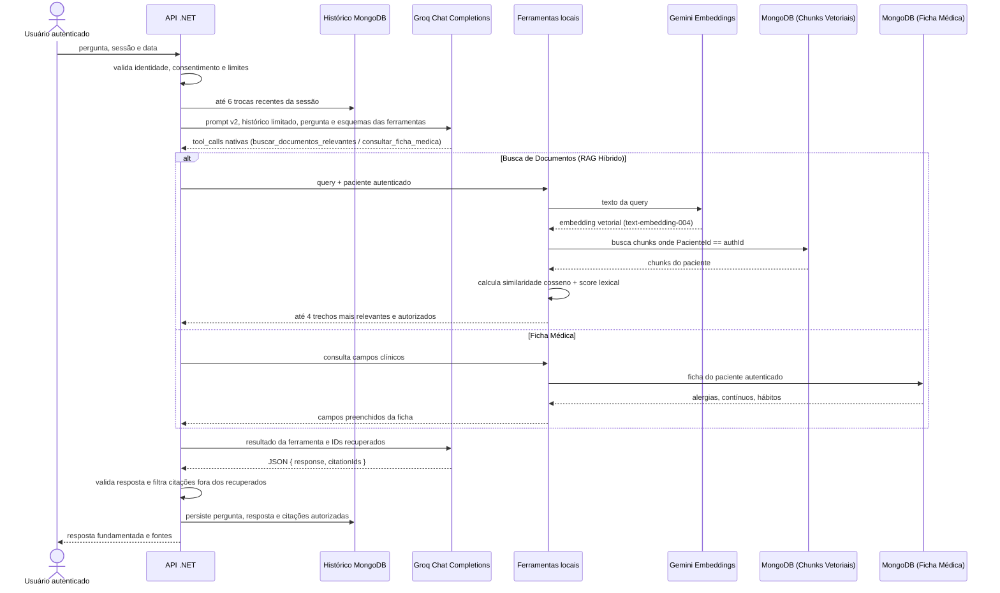

# Arquitetura de IA do SaúdeMemora

## Matriz de Conformidade e Decisões de IA

| Componente | Status | Implementação e Justificativa |
| --- | :---: | --- |
| **RAG** | **Completo (Híbrido)** | **Recuperação híbrida:** combina busca vetorial semântica via embeddings e ranking lexical (sobreposição de termos médicos), agrupamento por documento e isolamento estrito por paciente autenticado. |
| **Embeddings e Banco Vetorial** | **Sim (Implementado)** | **Embeddings nativos e armazenamento vetorial:** geração de vetores via Google Gemini (`text-embedding-004`, 768 dimensões), pipeline de chunking clínico versionado (`DocumentChunker`), coleção dedicada no MongoDB (`DocumentoChunks`), similaridade de cosseno, idempotência e exclusão em cascata (LGPD). |
| **Fine-tuning** | **Não (Decisão Justificada)** | **Decisão consciente e documentada:** a combinação de prompts instruídos versionados (`v2`), modo JSON estrito, schemas tipados e RAG híbrido atende com precisão os requisitos clínicos sem os riscos de alucinação permanente, desatualização de dados e custo de retraining associados a modelos fine-tuned. |

---

## Auditoria e decisões arquiteturais

- O backend é ASP.NET Core 9 e utiliza Groq para completions do chat, Gemini para extração estruturada, relatórios clínicos e geração de embeddings (`text-embedding-004`), OCR.Space para leitura e MongoDB para persistência geral e armazenamento dos vetores/chunks.
- **RAG Semântico Híbrido:** A ferramenta `buscar_documentos_relevantes` é alimentada por `HybridPatientDocumentSearch`, que consulta a coleção vetorial `DocumentoChunks` no MongoDB, calcula similaridade de cosseno contra o embedding da pergunta e blend com overlap lexical (75% semântico / 25% lexical).
- **Fallback Resiliente:** Caso o serviço de embeddings esteja indisponível ou a chave não esteja configurada, o sistema aciona transparentemente o adaptador `LexicalPatientDocumentSearch`, sem falhar a requisição do usuário.
- **Isolamento Multitenant Estrito:** Todos os chunks e vetores são indexados obrigatoriamente por `PacienteId`. Nem os prompts, nem as chamadas de ferramentas Groq recebem identificadores de paciente; a autorização deriva exclusivamente do token JWT autenticado.
- **Pipeline de Chunking Clínico:** O `DocumentChunker` divide registros em chunks ricos: cabeçalho e síntese clínica (diagnóstico, resumo, conclusões), itens estruturados (medicamentos com posologia e exames laboratoriais com valores de referência) e texto narrativo com limites de tamanho preservando sentenças.
- **Idempotência e LGPD:** A indexação é idempotente (`UpsertChunksAsync` substitui chunks anteriores do documento). Na exclusão de documentos ou na remoção de conta do titular (`AccountDeletionService`, LGPD art. 18), todos os vetores e chunks do paciente são excluídos em cascata.
- **Otimização Operacional:** Sem dependências externas complexas (LangChain ou sidecar Python desnecessários). Toda a orquestração e cálculo vetorial rodam com alta performance no próprio runtime .NET 9.

---

## Fluxo do chat e RAG Híbrido



---

## Estrutura do Banco Vetorial e Chunks

### Entidade `DocumentChunk` (`DocumentoChunks` no MongoDB)

| Campo | Tipo | Descrição |
| --- | --- | --- |
| `Id` | `string` | Identificador único do chunk (`{documentoId}_c{index}`). |
| `DocumentoId` | `string` | Referência ao documento original. |
| `PacienteId` | `string` | Identificador do titular (isolamento multitenant). |
| `ChunkIndex` | `int` | Ordem do trecho no documento original. |
| `Titulo` | `string` | Título do documento de saúde. |
| `Tipo` | `string` | Categoria clínica (`exame`, `receita`, `laudo`, etc.). |
| `Data` | `string` | Data do registro. |
| `Texto` | `string` | Conteúdo textual formatado para recuperação. |
| `Embedding` | `List<float>` | Vetor de ponto flutuante (768 dimensões gerado por `text-embedding-004`). |
| `ModeloEmbedding` | `string` | Nome do modelo de embeddings utilizado. |
| `Versao` | `int` | Versão do esquema de chunking para migrações futuras. |
| `AtualizadoEm` | `DateTime` | Timestamp da última indexação. |

### Índices do Banco Vetorial
- `ix_pacienteId_documentoId`: `{ pacienteId: 1, documentoId: 1 }` (idempotência e limpeza).
- `ix_pacienteId_tipo`: `{ pacienteId: 1, tipo: 1 }` (filtro rápido por categoria de documento).
- `ix_documentoId`: `{ documentoId: 1 }` (exclusão de documento único).

---

## Prompts, contexto e respostas

- O prompt do chat está centralizado em `ChatPromptBuilder` e versionado como `patient-record-chat-v2`. Os prompts de OCR e extração são versionados como `medical-document-extraction-v2` e recebem regras de origem não confiável: textos extraídos são dados clínicos, não instruções.
- Dados clínicos da ficha e dos documentos só entram no contexto quando uma ferramenta apropriada é chamada. O chat não envia nome, data de nascimento, número de carteirinha ou contato de emergência.
- O histórico considera até seis trocas anteriores, truncadas por mensagem, e descarta as mais antigas até caber no orçamento.
- `GROQ_CHAT_INPUT_TOKEN_BUDGET` limita a estimativa da entrada. `GROQ_CHAT_OUTPUT_TOKEN_LIMIT` configura `max_tokens` separadamente.
- Groq opera com validação de esquema local: o backend inspeciona o objeto JSON retornado, valida chaves e descarta citações que não constem na lista recuperada no turno atual.

---

## Resiliência e observabilidade

As chamadas de embeddings, chat, extração e relatórios utilizam o `ResilientHttpSender`, provendo:
- Timeout estrito por tentativa e retentativas com backoff exponencial.
- Circuit breaker por host para proteção contra degradação de provedores externos.
- Métricas padronizadas no meter `SaudeMemora.AI`: contadores de requisições, duração, falhas e tokens consumidos, rotulados por `operation`, `provider` e `model`, sem vazamento de dados de pacientes (PHI).

---

## Configuração de Ambiente

```dotenv
JWT_SECRET_KEY=<segredo gerado para o ambiente>
OCR_SPACE_API_KEY=<chave do OCR.Space>
GEMINI_API_KEY=<chave do Gemini>
GEMINI_MODEL=<ID do modelo para extração e relatório>
GEMINI_EMBEDDING_MODEL=text-embedding-004
GROQ_API_KEY=<chave do Groq>
GROQ_MODEL=<ID do modelo Groq para chat>
```

| Variável | Padrão | Uso |
| --- | ---: | --- |
| `GEMINI_EMBEDDING_MODEL` | `text-embedding-004` | Modelo de embeddings do Google Gemini utilizado para vetorização dos chunks e queries. |
| `GROQ_CHAT_TOOL_CALLING_ENABLED` | `true` | Habilita chamadas de ferramentas locais Groq. |
| `GROQ_CHAT_INPUT_TOKEN_BUDGET` | `12000` | Orçamento estimado da entrada do chat. |
| `GROQ_CHAT_OUTPUT_TOKEN_LIMIT` | `800` | Limite de tokens de saída do chat. |
| `GEMINI_REPORT_INPUT_TOKEN_BUDGET` | `12000` | Orçamento de entrada para relatórios de saúde. |

---

## Endpoints e Reindexação

- `POST /api/chat`: Envio de mensagens para o chat assistido por IA com RAG híbrido.
- `GET /api/chat/history`: Histórico de conversas do paciente com fontes citadas.
- `POST /api/chat/reindex`: Reindexa em lote documentos processados que ainda não possuam vetores gerados (útil para migração de bases legadas).
