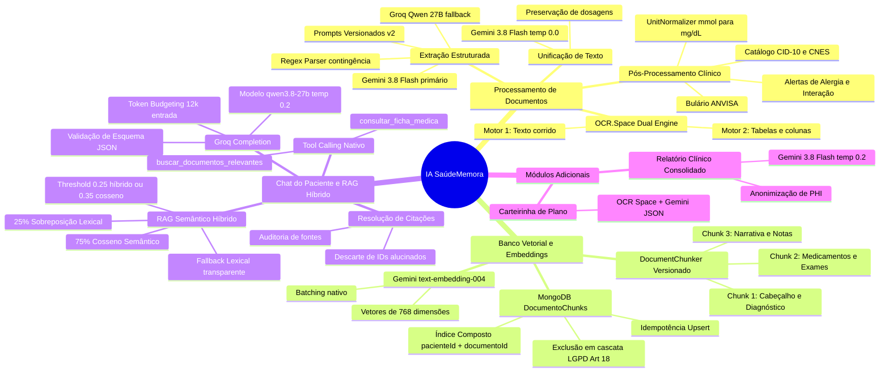
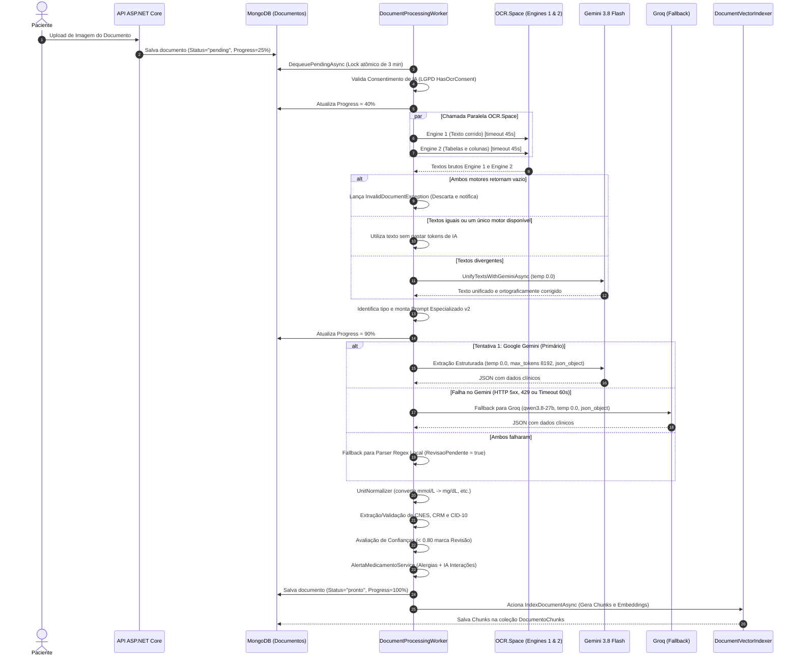
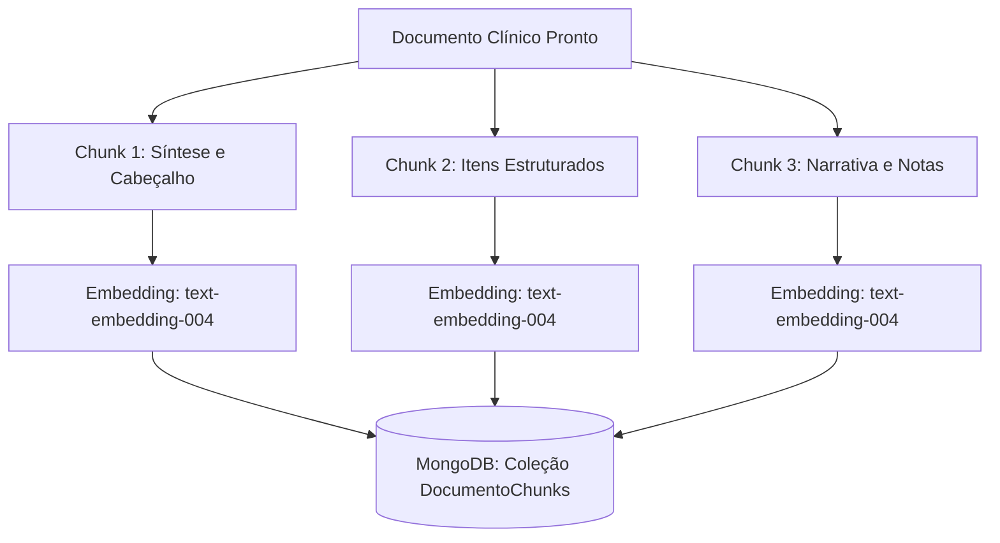
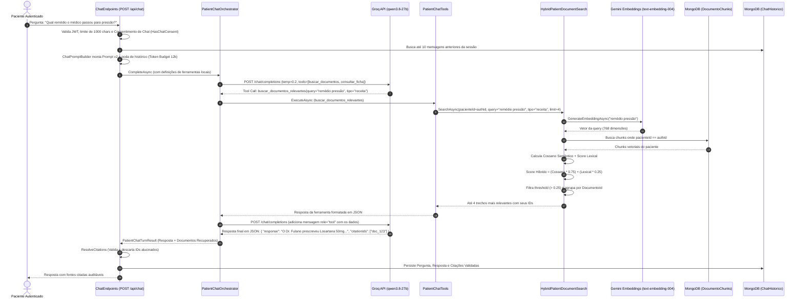

# 🏥 SaúdeMemora

  
  
  
  
  
  

> **Digitalize, organize e acesse documentos médicos com inteligência.**  
> Aplicação para organizar documentos de saúde e consultar informações extraídas com OCR e Inteligência Artificial. Os dados extraídos podem conter erros e devem ser conferidos pelo usuário e por profissionais de saúde.

## 🔗 Acesse o projeto

👉 https://saude-memora.vercel.app

---

## 🚀 Principais Benefícios

Com o **SaúdeMemora**, o usuário pode:

- 📄 **Evitar a perda de documentos importantes**: Digitalize papéis usando a câmera ou fazendo upload.
- 🩺 **Histórico médico unificado**: Receitas, exames, laudos, atestados e encaminhamentos em um só lugar.
- ⚡ **Acesso rápido em emergências**: Veja alergias, doenças crônicas e seu tipo sanguíneo instantaneamente no Dashboard.
- 🔒 **Extração assistida**: OCR e IA podem sugerir nome do médico, clínica, data e medicamentos a partir dos documentos. A extração não é garantida nem substitui a conferência do original.

---

## ⚙️ Funcionalidades Atuais (Versão 2.0)

**1. Processamento Inteligente de Documentos**
- **Upload Inteligente com Seletor de Tipo**: Categorize o arquivo (Exame, Receita, Laudo, Atestado, Vacina, Encaminhamento) antes do upload.
- **Integração com Câmera**: Capture documentos ou fotos da carteirinha do convênio diretamente pela câmera do celular ou webcam.
- **OCR e IA por tipo de documento**: O processamento usa instruções específicas para cada tipo; os resultados podem ser incompletos ou incorretos e precisam de revisão.
- **Extração de Medicamentos**: A IA identifica remédios, dosagens e horários automaticamente.

**2. Carteirinha do Convênio e Perfil**
- Anexe a foto da sua carteirinha do plano de saúde.
- A IA extrai automaticamente o **nome do plano** e o **número da carteirinha**.
- Acesso rápido na tela de Visão Geral (Dashboard) através de um visualizador interativo (modal).

**3. Visão Geral (Dashboard)**
- **Métricas e Destaques**: Contagem total de exames, atestados e medicamentos mais frequentes.
- **Informações de saúde**: A ficha pode exibir alergias e doenças crônicas cadastradas pelo usuário. Confira esses dados com um profissional de saúde.
- **Busca Rápida**: Documentos recentes estruturados em tabela.

**4. Arquivo de Documentos**
- Filtros combinados para tipo, status e período.
- Busca por título, nome do médico, clínica e conteúdo extraído.

**5. Ficha Médica (Anamnese)**
- Cadastro detalhado de histórico familiar, cirurgias, doador de órgãos, tipo sanguíneo e hábitos.
- Bloqueio inteligente: Novos usuários são convidados a preencher a anamnese para popular os alertas do sistema.

**6. Experiência de Usuário (UX)**
- Interface responsiva, suporte a tema noturno e avisos para acompanhar o processamento e corrigir os dados extraídos.

---

## 🛠️ Tecnologias Utilizadas

- **Frontend:** React + Vite, TailwindCSS (Vanilla UI), React Query (Cache e mutations), Wouter.
- **Backend:** C# ASP.NET Core 9 Minimal API.
- **Inteligência Artificial:** OCR.Space para leitura, Gemini para extração estruturada e relatórios, e Groq para o Chat e fallback de extração. Os IDs dos modelos são configurados por `GEMINI_MODEL` e `GROQ_MODEL`.
- **Banco de Dados:** MongoDB para dados da aplicação.
- **Storage:** Cloudinary para arquivos enviados, quando configurado.

### IA generativa e recuperação

O chat mantém o consentimento e a autenticação existentes, usa chamadas de ferramenta locais do Groq para consultar a ficha médica e buscar documentos do próprio paciente via **RAG Híbrido** (busca semântica com embeddings Google Gemini `text-embedding-004` armazenados no banco vetorial MongoDB com similaridade de cosseno e sobreposição lexical), limitando histórico, entrada e saída. Consulte [docs/ai-architecture.md](docs/ai-architecture.md) para o fluxo completo, matriz de conformidade, decisões e variáveis de ambiente.

---

## ⚕️ Uso responsável e privacidade

O SaúdeMemora organiza documentos e informações fornecidas pelo usuário. Não é um serviço de diagnóstico ou aconselhamento médico, não substitui avaliação profissional e não deve ser usado para decisões clínicas ou emergências. Em uma emergência, procure os serviços de emergência locais.

Arquivos e dados de saúde são sensíveis. Conforme as integrações habilitadas, o processamento pode envolver Cloudinary para arquivos, OCR.Space para leitura, Google Gemini para interpretação, Groq para o Chat e fallback de extração, e Brevo para e-mail. MongoDB guarda os dados estruturados. Configure `GEMINI_MODEL` e `GROQ_MODEL` com IDs atualmente suportados pelos respectivos provedores. Confirme os fluxos, contratos, localização e políticas de retenção dos fornecedores da sua implantação; atualize os avisos de privacidade/consentimento com a configuração real e valide requisitos legais e de segurança aplicáveis antes do uso. A aplicação não é, por si só, certificação de conformidade legal ou clínica. Não use dados reais em desenvolvimento ou demonstrações.

Chamadas mutáveis à API (`POST`, `PUT`, `PATCH` e `DELETE`) devem incluir `X-Requested-With: XMLHttpRequest` como proteção contra CSRF. O cliente web adiciona esse header automaticamente; clientes externos precisam enviá-lo também.

---

## 🧠 Arquitetura Completa de Inteligência Artificial

O **SaúdeMemora** adota uma arquitetura de IA ponta a ponta integrada ao runtime **ASP.NET Core 9 (.NET 9)** e **MongoDB**, combinando visão computacional (OCR duplo), extração estruturada de dados clínicos, checagem de interações medicamentosas e um assistente conversacional fundamentado em **RAG Semântico Híbrido** com busca vetorial e lexical.

> [!NOTE]
> Documentação técnica detalhada adicional: [docs/arquitetura-ia-fluxo-completo.md](docs/arquitetura-ia-fluxo-completo.md) e [docs/ai-architecture.md](docs/ai-architecture.md).

### 1. Matriz de Conformidade e Decisões de IA

| Componente | Status | Implementação e Justificativa |
| --- | :---: | --- |
| **RAG** | **Completo (Híbrido)** | **Recuperação híbrida:** combina busca vetorial semântica via embeddings e ranking lexical (sobreposição de termos médicos), agrupamento por documento e isolamento estrito por paciente autenticado via JWT. |
| **Embeddings e Banco Vetorial** | **Sim (Implementado)** | **Embeddings nativos e armazenamento vetorial:** geração de vetores via Google Gemini (`text-embedding-004`, 768 dimensões), pipeline de chunking clínico versionado (`DocumentChunker`), coleção dedicada no MongoDB (`DocumentoChunks`), similaridade de cosseno, idempotência e exclusão em cascata (LGPD Art. 18). |
| **Fine-tuning** | **Não (Decisão Justificada)** | **Decisão consciente e documentada:** a combinação de prompts instruídos versionados (`v2`), modo JSON estrito, schemas tipados e RAG híbrido atende com precisão os requisitos clínicos sem os riscos de alucinação permanente, desatualização de dados e custo de retraining associados a modelos fine-tuned. |

---

### 2. Mapa Mental Global do Ecossistema de IA

---

### 3. Pipeline de Processamento e Extração de Documentos (Worker & OCR/IA)

O processamento é assíncrono e orquestrado pelo `DocumentProcessingWorker` (.NET 9 BackgroundService), com lock atômico de **3 minutos** no MongoDB e concorrência configurável de **3 a 16 documentos em paralelo** (`DOCUMENT_WORKER_CONCURRENCY`).

#### Etapas do Processamento:
1. **Dual-Engine OCR (OCR.Space):** Disparo simultâneo no Motor 1 (texto corrido) e Motor 2 (`isTable=true`, `scale=true` para tabelas de exames laboratoriais). Timeout de 45 segundos por motor.
2. **Unificação Inteligente (`UnifyTextsWithGeminiAsync`):** Quando os motores divergem, o Gemini 3.8 Flash (`temperature = 0.0`) harmoniza a ortografia sem alterar números, vírgulas, unidades ou dosagens.
3. **Prompts Especializados Versionados (`medical-document-extraction-v2`):** Prompts dedicados para `Receita`, `Atestado`, `Laudo`, `ExameLaboratorial`, `ExameImagem`, `Encaminhamento`, `Vacina` e `Clinico`. Protegidos contra *Prompt Injection* pelo envelope `AiPrompts.ProtectUntrustedSource`.
4. **Multi-Provider com Fallback Automático:** Gemini 3.8 Flash como provedor primário (`temperature = 0.0`, `max_tokens = 8192`, `json_object`). Se houver falha, aciona o Groq (`qwen/qwen3.8-27b`). Se ambos falharem, aciona o parser regex de contingência com alerta de revisão.
5. **Normalização de Unidades (`UnitNormalizer`):** Conversão automática e matemática de exames:
   - Glicemia: `mmol/L` $\to$ `mg/dL` ($\times 18.02$)
   - Colesterol: `mmol/L` $\to$ `mg/dL` ($\times 38.67$)
   - Triglicerídeos: `mmol/L` $\to$ `mg/dL` ($\times 88.57$)
   - Creatinina: `µmol/L` $\to$ `mg/dL` ($\times 0.011312$)
   - Vitamina D: `nmol/L` $\to$ `ng/mL` ($\times 0.4006$)
   - Vitamina B12: `pmol/L` $\to$ `pg/mL` ($\times 1.355$)
   - Hemoglobina: `g/L` $\to$ `g/dL` ($\div 10$)
6. **Alertas Clínicos (`AlertaMedicamentoService`):**
   - Checagem determinística de duplicidades (contra remédios contínuos da anamnese ou na mesma receita).
   - Checagem determinística de alergias expandida por classes farmacológicas (ex: Dipirona/Metamizol, Penicilina/Amoxicilina).
   - Checagem por IA generativa (Gemini, `temp = 0.0`) para identificar interações fármaco-fármaco entre todos os medicamentos.
7. **Score de Confiança:** Qualquer campo com confiança inferior a $0.80$ (ou medicamento sem dosagem legível) sinaliza o documento com `RevisaoPendente = true`.

---

### 4. Banco Vetorial, Chunking Clínico e Embeddings

Diferente de sistemas que cortam texto de forma cega por caracteres, o SaúdeMemora utiliza **Chunking Clínico Estruturado**:

1. **Estratégia dos Chunks (`DocumentChunker`):**
   - **Chunk 1 (Síntese e Cabeçalho):** Título, tipo, data, médico, clínica, especialidade, resumo e conclusões diagnósticas.
   - **Chunk 2 (Itens Estruturados):** Medicamentos completos (nome, dosagem, horário) e resultados de exames com referências e valores.
   - **Chunk 3 (Narrativa e Observações):** Segmentos de texto narrativo com limite de até **800 caracteres** preservando pontuação (mínimo de 30 caracteres).
2. **Modelo de Embeddings (`GeminiEmbeddingService`):**
   - Modelo: `text-embedding-004` (Google Generative AI).
   - Dimensionalidade: **768 dimensões** (`float[]`).
   - Processamento em lote (`batchEmbedContents`) com timeout de 15 segundos.
3. **Coleção `DocumentoChunks` no MongoDB:**
   - Índices de alta performance: `ix_pacienteId_documentoId`, `ix_pacienteId_tipo`, `ix_documentoId`.
   - **Idempotência:** `UpsertChunksAsync` limpa chunks anteriores antes de reinserir, evitando duplicações.
   - **LGPD (Art. 18):** Ao excluir um documento ou a conta do paciente (`AccountDeletionService`), todos os chunks vetoriais do usuário são expurgados em cascata.

---

### 5. Pipeline do Chat Clínico e RAG Semântico Híbrido

O chat assistente opera via `POST /api/chat`, consumindo o modelo Groq com orquestração de **Tool Calling nativo** e **RAG Híbrido**:

#### Detalhes do Algoritmo RAG Híbrido:
1. **Similaridade de Cosseno:**
   $$\text{CosineSim}(\vec{Q}, \vec{C}) = \frac{\vec{Q} \cdot \vec{C}}{\|\vec{Q}\| \|\vec{C}\|}$$
2. **Sobreposição Lexical:** Densidade de termos médicos coincidentes entre a pergunta e o chunk (descartando stopwords).
3. **Score Ponderado:**
   $$\text{HybridScore} = (\text{CosineSim} \times 0.75) + (\text{NormalizedLex} \times 0.25)$$
4. **Filtro e Agrupamento:** Considera apenas $\text{HybridScore} > 0.25$ ou $\text{CosineSim} > 0.35$. Agrupa por `DocumentoId` selecionando o melhor trecho de cada documento, limitado aos **4 documentos mais relevantes** (máximo de 1.500 caracteres por trecho).
5. **Fallback Lexical:** Se a API de embeddings estiver inacessível, o adaptador `LexicalPatientDocumentSearch` assume a busca sem quebrar o chat do usuário.
6. **Resolução de Citações Antialucinação:** O backend confere os `citationIds` retornados pelo modelo. Qualquer ID que não conste na lista de trechos realmente entregues pelas ferramentas é **descartado antes de salvar e responder**.

---

### 6. Configurações, Parâmetros e Variáveis de Ambiente (.env)

| Variável | Valor Padrão | Intervalo / Tipo | Módulo | Função e Comportamento |
| :--- | :---: | :---: | :--- | :--- |
| `GROQ_API_KEY` | *(Obrigatório)* | String secreta | `GroqChatCompletionClient`, `DocumentProcessingService` | Chave de acesso à API do Groq para o chat conversacional e fallback. |
| `GROQ_MODEL` | `qwen/qwen3.8-27b` | Model ID | `ChatEndpoints`, `GroqChatCompletionClient` | Modelo Groq para completions com Tool Calling nativo. |
| `GROQ_CHAT_TOOL_CALLING_ENABLED` | `true` | Booleano | `ChatEndpoints`, `PatientChatOrchestrator` | Ativa chamadas dinâmicas a ferramentas locais pelo modelo. |
| `GROQ_CHAT_INPUT_TOKEN_BUDGET` | `12000` | 4.096 a 64.000 | `ChatEndpoints`, `ChatPromptBuilder` | Orçamento máximo de tokens de entrada antes de podar histórico. |
| `GROQ_CHAT_OUTPUT_TOKEN_LIMIT` | `800` | 128 a 4.096 | `ChatEndpoints`, `GroqChatCompletionClient` | Limite de tokens da resposta gerada (`max_tokens`). |
| `GEMINI_API_KEY` | *(Obrigatório)* | String secreta | `DocumentProcessingService`, `GeminiEmbeddingService` | Chave de acesso às APIs do Google Gemini. |
| `GEMINI_MODEL` | `gemini-3.8-flash` | Model ID | `DocumentProcessingService`, `AlertaMedicamentoService` | Modelo Gemini para extração estruturada e relatórios clínicos. |
| `GEMINI_EMBEDDING_MODEL` | `text-embedding-004` | Model ID | `GeminiEmbeddingService`, `DocumentVectorIndexer` | Modelo de geração de vetores densos (768 dimensões). |
| `GEMINI_REPORT_INPUT_TOKEN_BUDGET` | `12000` | 2.048 a 32.000 | `Program.cs` (Relatórios) | Limite máximo de tokens do payload para relatório consolidado. |
| `OCR_SPACE_API_KEY` | *(Obrigatório)* | String secreta | `DocumentProcessingService` | Chave para os dois motores OCR em português do OCR.Space. |
| `DOCUMENT_WORKER_CONCURRENCY` | `3` | 1 a 16 | `DocumentProcessingWorker` | Quantidade de documentos processados simultaneamente por instância. |

#### Temperaturas e Parâmetros em Código:
- **Extração de Documentos e Unificação (Gemini/Groq):** `temperature = 0.0` (zero absoluto: máxima fidelidade aos dados do laudo, sem invenções).
- **Interações Medicamentosas (Gemini):** `temperature = 0.0`.
- **Chat Assistente (Groq):** `temperature = 0.2` (baixo calor: equilibra naturalidade com precisão factual).
- **Relatório de Saúde (Gemini):** `temperature = 0.2`, `max_tokens = 1200`.

---

### 7. Estudo Comparativo: RAG Híbrido vs Fine-Tuning

```mermaid
graph LR
    subgraph FineTuningRisks[Riscos do Fine-Tuning com Dados de Pacientes]
        R1[Pesos Neurais Estáticos<br/>Exige retreino diário caro]
        R2[Alucinação Permanente<br/>Sem citação auditável de fonte]
        R3[Violação Crônica da LGPD<br/>Impossível deletar dados da rede]
        R4[Vazamento entre Pacientes<br/>Data Leakage nos pesos]
    end

    subgraph RagAdvantages[Vantagens do RAG Híbrido no SaúdeMemora]
        A1[Atualização Instantânea<br/>Indexou, já está no chat]
        A2[100% Auditável<br/>Cita ID exato do documento]
        A3[LGPD Nativa<br/>Exclusão total no MongoDB]
        A4[Isolamento Multitenant<br/>Filtrado por Token JWT]
    end

    FineTuningRisks -. Substituído por .-> RagAdvantages
```

#### Por que Fine-Tuning NÃO foi adotado para dados de pacientes:
1. **Dados Hiperdinâmicos:** Novos exames chegam todo dia. O RAG indexa em segundos no MongoDB. O Fine-Tuning exigiria retreinamento diário em GPUs custando milhares de dólares e gerando problemas de esquecimento catastrófico (*Catastrophic Forgetting*).
2. **Conformidade LGPD (Artigo 18 - Direito ao Esquecimento):** Se o paciente solicitar a exclusão da conta, o RAG remove os chunks no MongoDB imediatamente. Em modelos fine-tuned, "Machine Unlearning" (fazer a rede neural esquecer dados absorvidos em seus pesos) ainda é um problema em aberto na ciência da computação.
3. **Isolamento Multitenant e Segurança:** No RAG do SaúdeMemora, o filtro `pacienteId == authId` impede matematicamente que chunks de outro paciente entrem no contexto. No Fine-Tuning, ataques de engenharia de prompt poderiam vazar informações privadas de outros pacientes do treino.
4. **Auditabilidade Clínica:** O RAG devolve `citationIds` que o paciente clica no app para conferir o documento original emitido pelo médico. O Fine-Tuning responde "de memória" sem garantia de veracidade.

#### Cenários Futuros Válidos para Fine-Tuning:
- **Modelos de Visão Especializados:** Fine-tuning de TrOCR ou Donut exclusivamente para decifrar caligrafia médica manuscrita brasileira.
- **Small Language Models (SLMs) Locais:** Ajustar modelos compactos (1B a 3B parâmetros) quantizados em WebGPU/ONNX para rodar no próprio celular do paciente extraindo entidades clínicas sem enviar dados para a nuvem.
- **Embeddings Médicos de Domínio:** Ajustar o modelo vetorial para a ontologia nacional do SUS, TUSS e Bulário ANVISA.

